# Mermaid cheat-sheet + alternatives

Working syntax for each diagram type, common gotchas, and when to leave Mermaid. Read the
section you need; don't load the whole thing reflexively.

## Table of contents
- [Flowchart](#flowchart)
- [Sequence](#sequence)
- [Class](#class)
- [State](#state)
- [Entity-Relationship (ER)](#entity-relationship-er)
- [Gantt](#gantt)
- [Mindmap](#mindmap)
- [Pie / XY chart](#pie--xy-chart)
- [Git graph](#git-graph)
- [User journey](#user-journey)
- [C4 architecture](#c4-architecture)
- [Common gotchas](#common-gotchas)
- [Alternatives: Graphviz / D2 / PlantUML](#alternatives)

---

## Flowchart
Directions: `TD`/`TB` (top-down), `LR` (left-right), `BT`, `RL`.
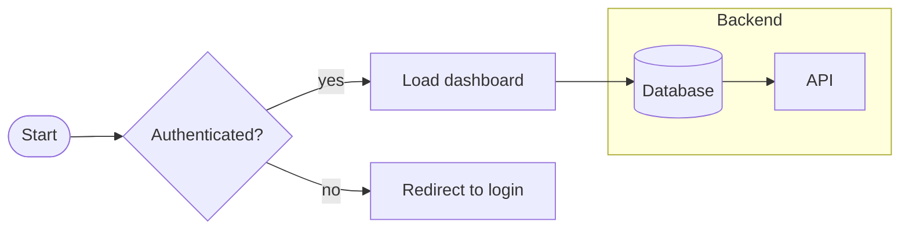
Node shapes: `[rect]` · `(rounded)` · `([stadium])` · `[[subroutine]]` · `[(database)]` ·
`((circle))` · `{rhombus/decision}` · `{{hexagon}}` · `[/parallelogram/]`.
Edges: `-->` arrow · `---` line · `-.->` dotted · `==>` thick · `-->|label|`.
Style: `classDef warn fill:#fee,stroke:#c00;` then `class B warn;`.

## Sequence
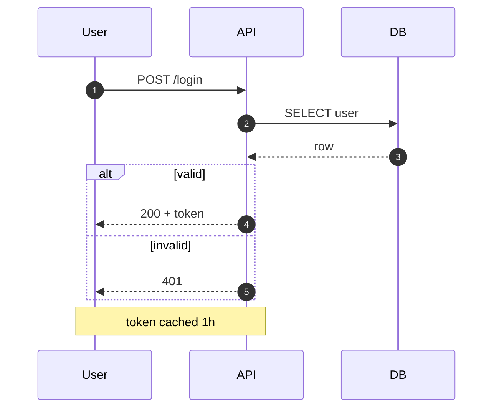
Arrows: `->>` solid call · `-->>` dashed return · `-)` async. Blocks: `alt/else`, `opt`,
`loop`, `par`, `critical`. `activate`/`deactivate` for lifelines.

## Class
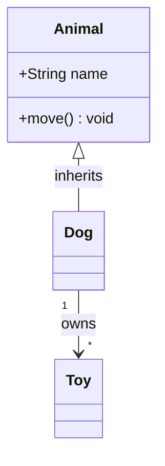
Relations: `<|--` inheritance · `*--` composition · `o--` aggregation · `-->` association ·
`..>` dependency. Visibility: `+` public `-` private `#` protected.

## State
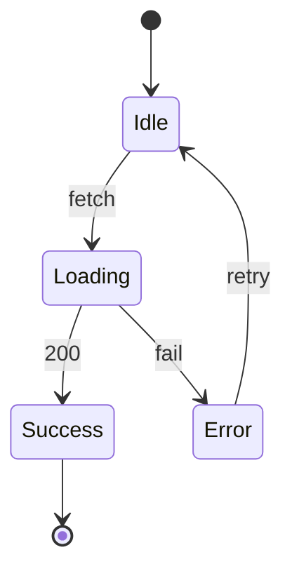
Supports nested `state Foo { ... }` and `<<choice>>`/`<<fork>>`.

## Entity-Relationship (ER)
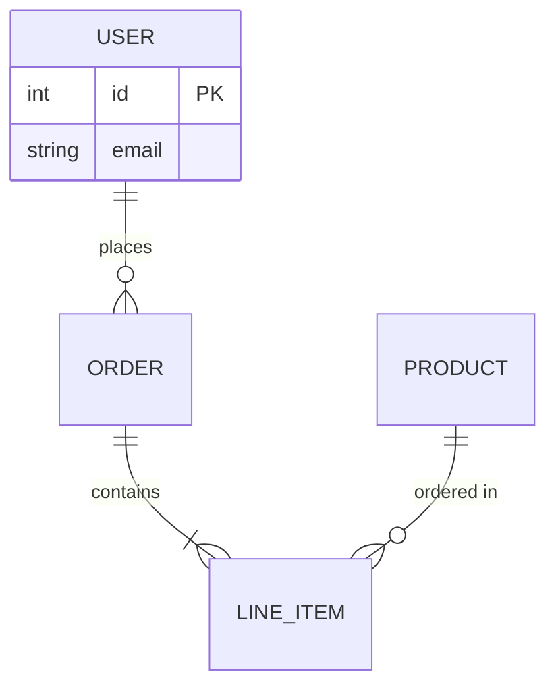
Cardinality: `||` exactly one · `o{` zero-or-many · `|{` one-or-many · `o|` zero-or-one.

## Gantt
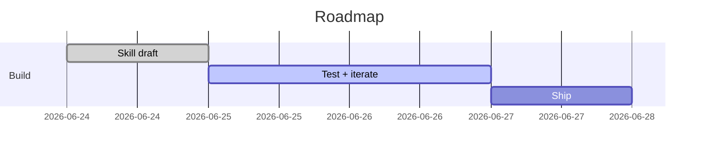

## Mindmap
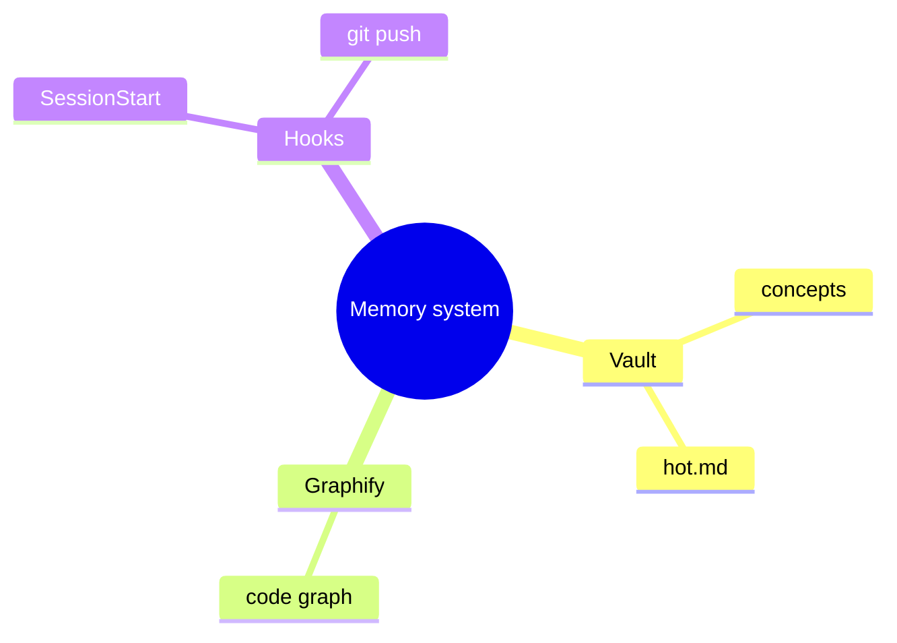

## Pie / XY chart
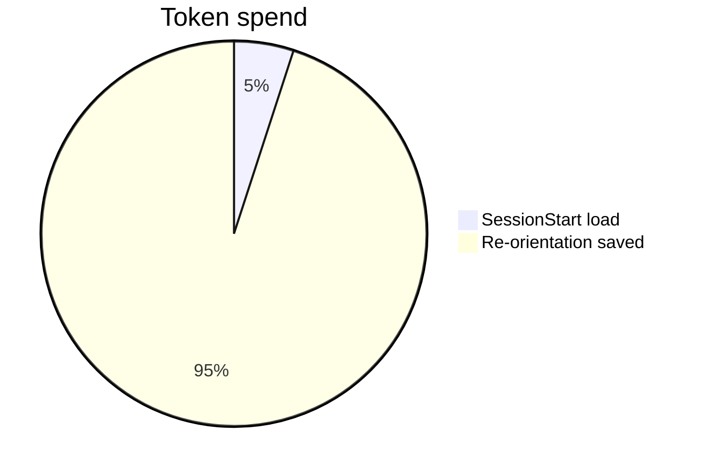
```mermaid
xychart-beta
    title "MAE by week"
    x-axis [w1, w2, w3, w4]
    y-axis "MAE" 0 --> 8
    line [6.2, 5.8, 5.1, 4.9]
```

## Git graph
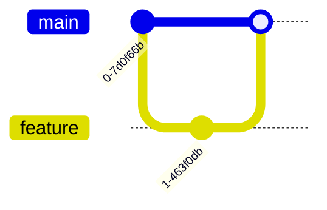

## User journey
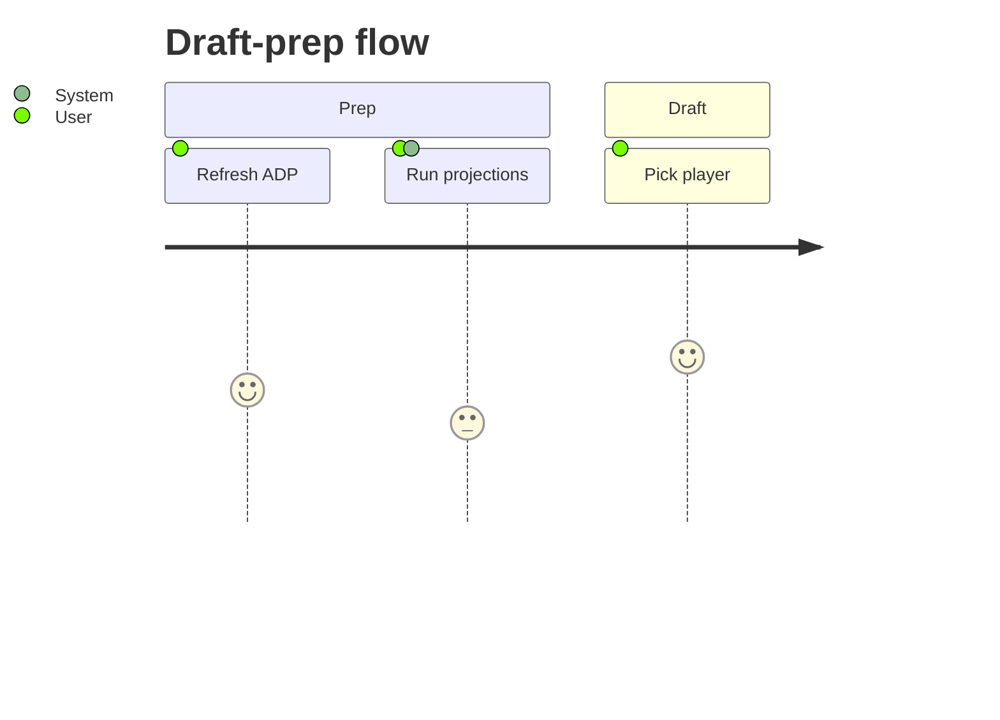

## C4 architecture
Mermaid has `C4Context` / `C4Container` for C4-model system diagrams. For most "show the
architecture" asks a `flowchart` with `subgraph` boundaries is simpler and reads fine; use C4
when the user specifically wants C4 semantics (Person/System/Container/Component + boundaries).
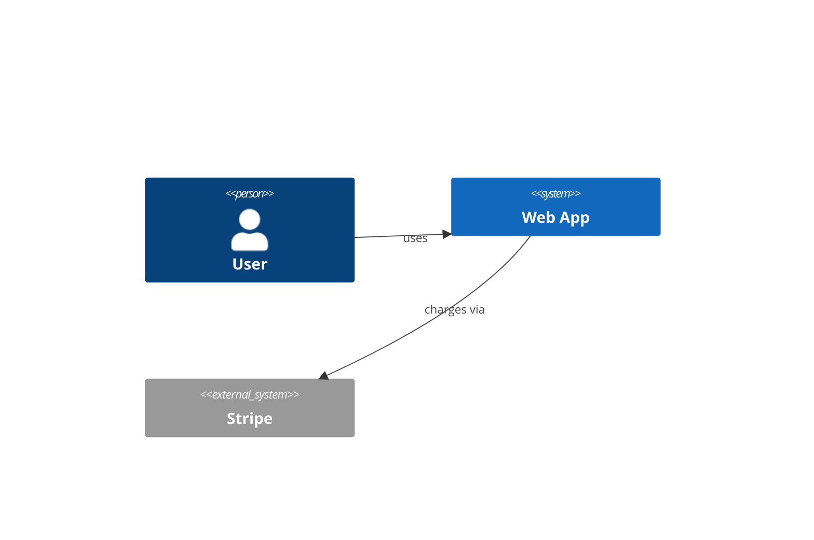

## Common gotchas
- **Reserved/special characters in labels:** wrap in quotes — `A["Node (v2): a/b"]`. Parens,
  colons, slashes, and `#` inside bare labels break parsing.
- **`end` is reserved** — don't name a node `end` (lowercase) in flowcharts; use `End` or quote it.
- **Edge labels with spaces:** `A -->|"two words"| B` or `A -- two words --> B`.
- **Comments:** lines starting with `%%`.
- **Validate before delivering** if exporting: `npx -y @mermaid-js/mermaid-cli -i d.mmd -o d.svg`
  fails loudly on syntax errors — cheaper than shipping a broken block.
- Keep one diagram per code block; don't concatenate types.

---

## Alternatives

Only when Mermaid genuinely can't do it. You lose in-Markdown rendering, so justify the switch.

### Graphviz (DOT) — dense/large graphs, precise auto-layout
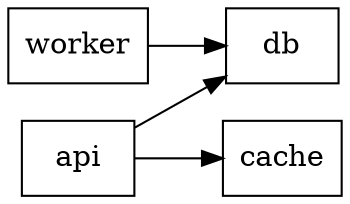
Render: `dot -Tsvg deps.dot -o deps.svg`. Best for dependency graphs, call graphs, anything
with many nodes where Mermaid's layout gets tangled.

### D2 — modern look, good for architecture
```d2
user -> app: request
app -> db: query
app.shape: rectangle
```
Render: `d2 in.d2 out.svg` (needs the `d2` binary installed). Nicer default aesthetics; use
when the diagram is a deliverable and looks matter.

### PlantUML — deep UML
For full UML beyond Mermaid's subset (component, deployment, detailed sequence with framing).
Needs Java + the PlantUML jar. Only worth it for serious UML work.
